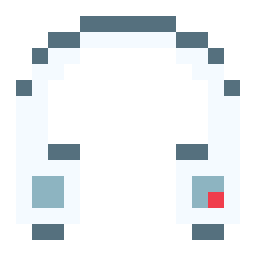
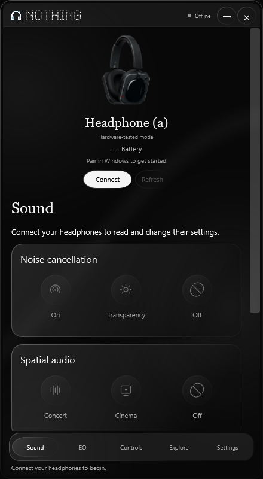
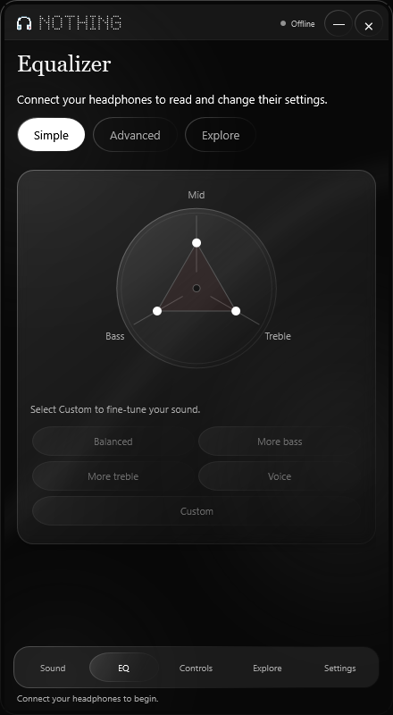
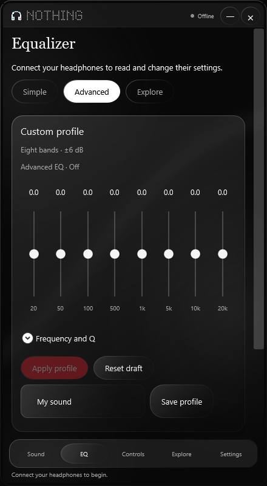
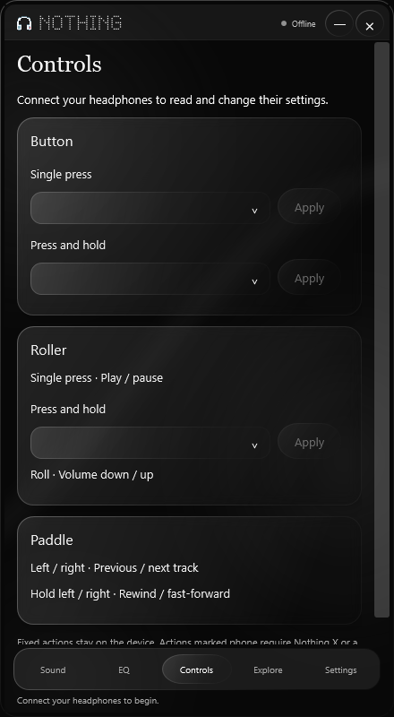
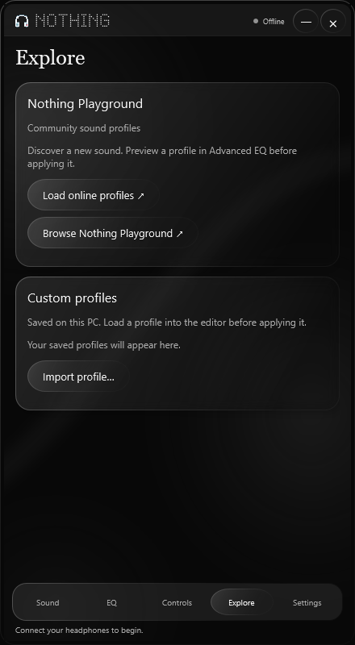
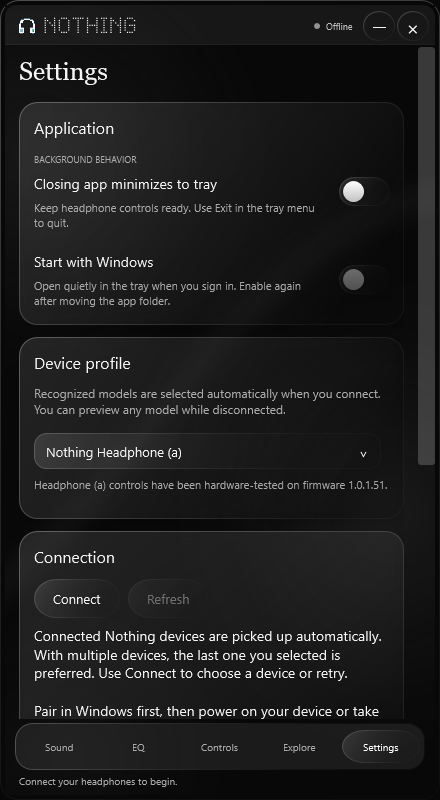

<p align="center"></p>

# Nothing on Windows

A compact, unofficial Windows companion for Nothing headphones and earbuds. Control your sound, EQ, and device gestures in a black glass interface inspired by Nothing X.

**[Download for Windows](https://github.com/DotsIsDev/NothingOnWindows/releases/latest)** · **[Device compatibility](DEVICE_SUPPORT.md)** · **[Report an issue](https://github.com/DotsIsDev/NothingOnWindows/issues)**

**Early release:** Headphone (a) has been hardware-tested with firmware `1.0.1.51`. The other ten device profiles are experimental; their presence does not guarantee compatibility with every device or firmware. This project is not affiliated with or endorsed by Nothing.

## See the app

Actual application renders at its default 440 × 800 portrait size. These show disconnected previews; controls become available after the app reads the connected device. Product photos belong to Nothing and/or its licensors.

<table>
  <tr><th>Sound</th><th>Simple EQ</th><th>Advanced EQ</th></tr>
  <tr>
    <td></td>
    <td></td>
    <td></td>
  </tr>
  <tr><th>Controls</th><th>Explore</th><th>Settings</th></tr>
  <tr>
    <td></td>
    <td></td>
    <td></td>
  </tr>
</table>

Explore loads its online catalog on request; the screenshot shows its initial state.

## Download and connect

1. Download `NothingOnWindows-v0.1.1-win-x64.zip` from [Releases](https://github.com/DotsIsDev/NothingOnWindows/releases/latest).
2. Extract the whole ZIP, then open `NothingOnWindows/NothingOnWindows.exe`. Keep the extracted files together. No installation or administrator access is needed.
3. Pair your device in **Windows Settings → Bluetooth & devices**, and power it on. For earbuds, take them out of their case.
4. The app automatically opens its control connection when Windows reports your device connected. If several devices are connected, it prefers your last selection; otherwise use **Connect** to choose one.

The portable package includes the .NET runtime. It targets **Windows 10 version 2004 (build 19041) or newer, x64**, with Bluetooth support. The executable is currently unsigned. Exit an older copy from its tray menu before launching an update.

If connection fails, close Nothing X on your phone and try again. For a renamed device, use **Settings → Connect a renamed device…** and select its model. Audio playback remains managed by Windows; this app uses a separate Bluetooth control connection and does not install an audio driver.

## Features

Available controls depend on the selected model, firmware, and successful device reads.

| Area | Features |
| --- | --- |
| Noise control | ANC strengths, adaptive mode, transparency, and off where available |
| Spatial audio | Concert/cinema or fixed/head tracking, depending on the device |
| Bass enhancement | Two levels on Headphone (a), five on other supported profiles |
| Simple EQ | Balanced, More bass, More treble, Voice, and custom bass/mid/treble where supported; graphs update with preset selection |
| Advanced EQ | Eight bands, ±6 dB, frequency/Q editing, and local profile save/import/export |
| Explore | Community EQ profiles from Nothing's public Playground catalog, filtered by device |
| Controls | Model- and firmware-specific button, roller, earbud, and case assignments; fixed actions are labeled |
| Device settings | Battery/charging, firmware, low lag, and wearing detection where exposed |
| Live updates | Device notifications and read-only polling keep Sound and EQ in sync with physical controls |
| Desktop behavior | Resizable 11:20 portrait window, custom Minimize/Close, system tray menu, and optional Start with Windows |

Enable **Settings → Application → Closing app minimizes to tray** to keep the connection active when closing the window. This defaults to off. The tray menu offers **Open**, **Settings**, and **Exit**; Exit always quits.

Enable **Settings → Application → Start with Windows** to launch quietly in the tray when you sign in. It defaults to off and applies to your Windows account without administrator access. Keep the app in a permanent extracted folder; enable the toggle again after moving it. Windows Startup Apps settings can also control whether it launches.

Automatic discovery runs every five seconds while disconnected, including in the tray. Failed control connections retry after 30 seconds. Only devices already connected through Windows Bluetooth are eligible. The app controls one device at a time and remembers your last successful choice, including a renamed device's model. Choosing **Disconnect** pauses automatic connection until a successful manual reconnect or app restart.

## Device profiles

| Hardware-tested | Experimental profiles |
| --- | --- |
| Nothing Headphone (a), firmware 1.0.1.51 | Ear (1), Ear (2), Ear (2024), Ear (a), Ear (3), Ear (3a), Ear (stick), Ear (open), Headphone (1), Headphone (1) Pro |

Each profile has its own product image and feature layout. Known Bluetooth names select the matching profile automatically. Preview models in Settings while disconnected. CMF devices are outside the current scope.

See the [full capability and firmware matrix](DEVICE_SUPPORT.md) before using an experimental profile. Unsupported writes are rejected, and settings changes are checked with fresh device reads.

## Current limits

- Firmware updating and a signed installer are not included.
- Nothing X QR-code sharing is not implemented. Import/export uses this app's JSON profile format.
- Playground contains community profiles hosted by Nothing; it is not presented as Nothing-authored curated presets.
- Personal Sound setup, Auracast, proprietary Headphone (1) Pro Audiodo scenes and driver-specific EQ, and phone-only integrations are not implemented. Mapping a phone action does not add its integration to Windows.
- Physical-control synchronization and the ten experimental profiles still need broader testing on real devices and firmware.

## Build from source

On Windows, install the [.NET 10 SDK](https://dotnet.microsoft.com/en-us/download/dotnet/10.0), then run:

```powershell
git clone https://github.com/DotsIsDev/NothingOnWindows.git
cd NothingOnWindows
dotnet build NothingOnWindows.csproj -c Release
dotnet run --project tests/ProtocolChecks.csproj -c Release
dotnet run --project NothingOnWindows.csproj -c Release
```

Create the portable package, matching source archive, and SHA-256 checksums:

```powershell
powershell -ExecutionPolicy Bypass -File tools/PublishRelease.ps1 -Version 0.1.1
```

Packaging runs the core checks and offline UI/tray checks without connecting to headphones or writing their settings. See [development and validation notes](docs/DEVELOPMENT.md) for diagnostics and test coverage.

## Privacy and issue reports

Device control uses local Bluetooth. Explore contacts Nothing's public Playground service when requested. Settings and saved profiles are stored under `%LOCALAPPDATA%/NothingOnWindows`; there is no project telemetry service.

When [reporting an issue](https://github.com/DotsIsDev/NothingOnWindows/issues), include the app version, Windows version, model, firmware, and steps to reproduce it. Review connection reports before attaching them: they can contain device names, settings, and raw responses. Local reports and backups are excluded from this repository and release.

## License and credits

Application code and original artwork: **AGPL-3.0-or-later**, with corresponding source included in each portable release. See [LICENSE](LICENSE).

Protocol research and converted device-control definitions draw on [Ear (web)](https://github.com/radiance-project/ear-web) and [swift-nothing-ear](https://github.com/bestK1ngArthur/swift-nothing-ear). Attribution and reference revisions are in [THIRD_PARTY_NOTICES.md](THIRD_PARTY_NOTICES.md).

Nothing names, branding, and official product photographs belong to their respective owners. Photos are separate from the application's AGPL license; no license to those photos or official endorsement is claimed. Exact image sources are in [Assets/Devices/sources.json](Assets/Devices/sources.json).

